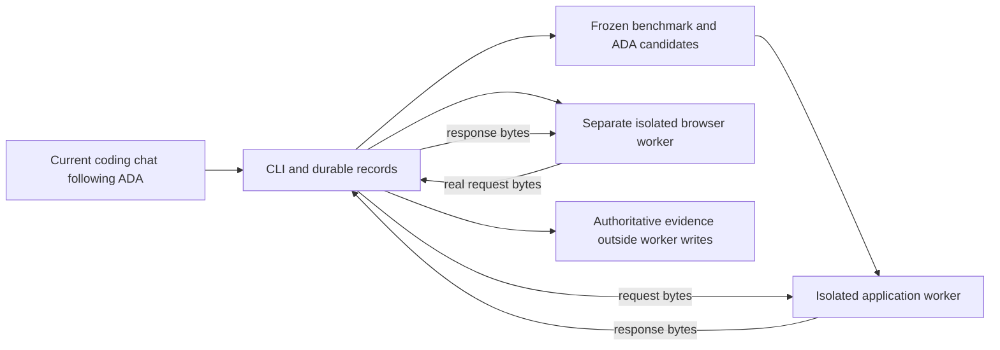

# Architecture and trust

## Standalone campaign layer

`campaigns.py` stores exact task/procedure manifests, ordered suites, explicit-profile campaign fingerprints, structured global ideas, atomic reservations and job journals under ignored `.lab/app/`. Full native/source evidence remains in the existing `.lab/experiments/` and `.lab/evaluations/`. Backups include these archives and exact integrity manifests.

`engine.py` is a sequential controller with a lifetime lock. Stage receipts precede completion, checkpoints bind their inputs, failed attempts remain counted, and uncertain usage stays unknown. Reopening pauses pending work rather than replaying model calls. Pause finishes the current bounded stage; Stop cancels it. Windows process jobs terminate workers and descendants when the controller exits. Exact-source confirmations reuse the candidate but develop fresh applications in varied arm order.

`adapters.py` dispatches task types through the same ordered scheduler. The installed Repair Queue adapter reuses the existing Lab/evaluator. Three-task deterministic fixtures exercise actual dispatch, partial resume and failed-task aggregation without claiming three real generated applications. Unsupported adapters/capabilities block before expensive execution.

`runtime.py` explicitly selects Codex CLI model/effort/provider and a native permission profile. ChatGPT authentication stays in its supported store; credentials and supervising-chat configuration are not inherited by worker tools. Only an assigned workspace is writable. Production, trusted Lab/evaluator, other arms and authoritative evidence remain protected. Runtime context corroborates model/effort/provider and managed filesystem/network policy; provider-side rerouting is not independently attested. Researcher/Developer and Critic/Reviewer use separate sessions with compact file handoffs.

`qa.py`/`journeys.js` execute actual Reviewer-selected API/browser actions, chosen before implementation and reused across arms. Final QA receives actual desktop/mobile images and quality observations without token/speed comparisons. `ledger.py` imports only the pinned trusted production validator for byte-scanning bookkeeping, never generated application code.

Browser text/count assertions wait up to six seconds through actual Playwright locators, including visibility/text selectors and zero counts; timeout evidence retains the failed step. The bounded action vocabulary includes real keyboard presses and one-use delayed actual repair-list responses. Delay rules must be consumed and completed; `settle` waits for those rules and in-flight requests, so an unused rule cannot claim stale-response coverage. The browser still receives real handler/SQLite response bytes. A failed asynchronous observation is not automatically an application defect. Final review receives protected preimplementation design receipts, stage chronology and complete Lead command observations outside its writable workspace. It performs Phase 3 source/behavior criticism before the controller binds authentic goal/code/capability observations and assesses the Phase 4 acceptance ledger.

Accepted ADA source may be transferred explicitly to a new campaign after a browser-action interpreter/validator update. Ordered task selection, suite policy, every task/starter/criteria/dependency byte and every other procedure must match; only `journeys.js` and `qa.py` may differ. The exact diffs are independently criticized in a new subscription session before application work. This reuses source and its provenance, never prior applications, outcomes or measurements. Other benchmark changes reject this narrow transfer. Both new applications still start clean under the new frozen suite and controller.

Candidate development has prospective independent design criticism before implementation and a separate final Reviewer that executes instruction-specific cases. Windows native isolation currently cannot run Git's MSYS submodule fixtures. A narrow documentation-only path checks pinned production identity and exact equality of every non-Markdown path/byte before running the unchanged trusted `check.py`/`evaluate.py` on a clean copy. Markdown is data to those audited programs. Any executable/config addition, deletion or modification blocks this host path; generated executable candidate code and benchmark applications never use it. Unsupported code-candidate regression remains BLOCKED. Full regression observations and original native failures are retained separately.

`web.py` serves a minimal loopback UI with exact Host/Origin/CSRF checks. Registered images and attachment downloads expose evidence; generated HTML never runs as privileged Lab UI. Opening the interface reads metadata but starts no model work.

Campaign policy v3 gates every required task on independent quality, then examines observed development tokens and autonomy; time is diagnostic. Non-dominated alternatives remain visible. A Champion requires three favorable exact-source pairs with at least two orders and fresh contexts; it is campaign-specific and does not promote production. Historical v1/v2 records below retain their own policies.

## Shared evaluator and legacy components

- `lab.py` owns locked, atomic experiment records, candidate snapshots, handoffs, review bindings, accounting and comparisons.
- `evaluator.py` defines the frozen HTTP/business criteria and evaluator calibration.
- `native.py` brokers bounded request/response frames between separate native workers.
- `backend_worker.py` imports the actual application handler in a disposable writable workspace.
- `browser_checks.js` drives a real browser in a different writable workspace; it relays actual UI requests to the application worker through the trusted parent.
- `sandbox.py` calls the installed platform's sandbox helper for ordinary process isolation. It never invokes `codex exec`, creates an AI session, or authenticates to a model provider.

## Native boundary

Before generated code executes, fresh probes must demonstrate writable disposable files, denied writes to ADA/Lab/evidence, denied private reads and link escapes, denied external/host-loopback connections, protected host processes and child cleanup. No unprotected fallback exists.

Application and browser have separate writable roots. They can read the runtime binaries and trusted worker source they need; public evaluator source is not treated as secret. Authoritative evidence is written by the parent outside their writable roots. Browser profiles and temporary files are disposable. The browser's own sandbox is disabled only inside the verified outer OS sandbox; the outer boundary remains mandatory.

Windows offline process isolation also blocks internal loopback and Python asyncio wakeup sockets. The browser worker therefore uses the Node driver bundled with the pinned Playwright package and debugging pipes. Browser requests are intercepted and transported to the actual application handler; no application responses are precomputed or mocked. Deliberate error injection tests only failure handling.

## Provenance and acceptance

Current-session receipts contain observer, session/tool reference, subject digest, observations and findings. The Lab checks completeness, digest freshness and declared observer separation. It cannot authenticate an unsigned receipt or prove that someone truly ran a command. Operational independence must be verified against the actual coding chat and independent Reviewer observations. A different string is not a security identity.

Design criticism is registered before `app.py` exists. Final behavior and code reviews bind the complete source digest. Corrections require new observations. The evaluator independently executes the frozen artifact, verifies its own input identities and leaves missing capabilities BLOCKED.

Trust assumptions: maintainers operating the current coding chat can edit Lab source and local records. Generated application code is the untrusted component. OS/runtime vulnerabilities, malicious maintainers and tampering outside the recorded tool boundary are not solved by local unsigned JSON. An evaluator source change invalidates calibration and any attempt to claim the new evaluator evaluated an old artifact.

## Legacy resource accounting and comparison

Registered work segments are not necessarily distinct provider sessions: the same current chat may perform multiple stages. Provider session count, model calls, tokens and monetary cost remain null unless a reliable export is supplied. Cached input is a subset of input and is not added twice. Research, application work, Reviewer work and deterministic evaluation remain separately visible. Failed/interrupted work and correction submissions stay in history.

The admission limit caps subsequent registered work segments. The user controls the current chat; Lab does not claim to stop it, detect subscription quota, enforce a provider token limit or switch to paid execution. Native worker operations have explicit byte and wall-time bounds and process-tree cleanup.

Comparisons bind artifact, benchmark, criteria, evaluator, model and environment. Mandatory quality is a gate; BLOCKED is inconclusive, not a measured application regression. No weighted universal score exists. One pair, public known tests, shared chat context and stable-first order limit any conclusion about efficiency or reliability.

New experiments freeze comparison policy v2. At equal passing quality it compares known development time, review time, corrections, interventions and provider resources independently. Favorable observed directions yield `Improvement observed`, adverse directions `Regression observed`, mixed directions `Trade-off observed`, ties `No demonstrated advantage`, and entirely missing evidence `Inconclusive result`. Unknown dimensions stay non-comparable; they do not veto a measured difference or justify an overall-efficiency claim. Timing ties use a prospectively fixed band of the larger of one second or two percent of baseline; this is a reporting rule, not a statistical confidence interval. Evaluation duration is a separate diagnostic and is not architecture-development efficiency.

Use timed work segments before dispatch and close them immediately after the assigned stage. A timed segment stores monotonic start/end and UTC audit bounds; uncertain clock continuity leaves duration null. Manual duration overrides are rejected for timed segments. Lead planning/implementation/correction, independent review, research and evaluation are reported separately. Role sums require every relevant segment to be closed and known. Dispatch-to-completion seconds include stage/tool overhead; they are neither inference-only time nor additive lifecycle elapsed when roles overlap. Active work blocks final completion.

Historical records without the new policy retain comparison v1. Recomputing a changed conclusion archives its previous snapshot; the published first pilot and its unknown timings are not rewritten. Comparison reports identify both the policy and the actual comparison-source digest. Per-run autonomy is explicit for new work; legacy experiment-wide intervention values are not used as per-variant evidence in v2.
