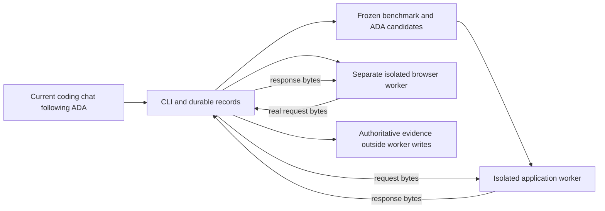

# Architecture and trust

## Components

- `lab.py` owns locked, atomic experiment records, candidate snapshots, handoffs, review bindings, accounting and comparisons.
- `evaluator.py` defines the frozen HTTP/business criteria and evaluator calibration.
- `native.py` brokers bounded request/response frames between separate native workers.
- `backend_worker.py` imports the actual application handler in a disposable writable workspace.
- `browser_checks.js` drives a real browser in a different writable workspace; it relays actual UI requests to the application worker through the trusted parent.
- `sandbox.py` calls the installed platform's sandbox helper for ordinary process isolation. It never invokes `codex exec`, creates an AI session, or authenticates to a model provider.

## Native boundary

Before generated code executes, fresh probes must demonstrate writable disposable files, denied writes to ADA/Lab/evidence, denied private reads and link escapes, denied external/host-loopback connections, protected host processes and child cleanup. No unprotected fallback exists.

Application and browser have separate writable roots. They can read the runtime binaries and trusted worker source they need; public evaluator source is not treated as secret. Authoritative evidence is written by the parent outside their writable roots. Browser profiles and temporary files are disposable. The browser's own sandbox is disabled only inside the verified outer OS sandbox; the outer boundary remains mandatory.

Windows offline process isolation also blocks internal loopback and Python asyncio wakeup sockets. The browser worker therefore uses the Node driver bundled with the pinned Playwright package and debugging pipes. Browser requests are intercepted and transported to the actual application handler; no application responses are precomputed or mocked. Deliberate error injection tests only failure handling.

## Provenance and acceptance

Current-session receipts contain observer, session/tool reference, subject digest, observations and findings. The Lab checks completeness, digest freshness and declared observer separation. It cannot authenticate an unsigned receipt or prove that someone truly ran a command. Operational independence must be verified against the actual coding chat and independent Reviewer observations. A different string is not a security identity.

Design criticism is registered before `app.py` exists. Final behavior and code reviews bind the complete source digest. Corrections require new observations. The evaluator independently executes the frozen artifact, verifies its own input identities and leaves missing capabilities BLOCKED.

Trust assumptions: maintainers operating the current coding chat can edit Lab source and local records. Generated application code is the untrusted component. OS/runtime vulnerabilities, malicious maintainers and tampering outside the recorded tool boundary are not solved by local unsigned JSON. An evaluator source change invalidates calibration and any attempt to claim the new evaluator evaluated an old artifact.

## Resource accounting and comparison

Registered work segments are not necessarily distinct provider sessions: the same current chat may perform multiple stages. Provider session count, model calls, tokens and monetary cost remain null unless a reliable export is supplied. Cached input is a subset of input and is not added twice. Research, application work, Reviewer work and deterministic evaluation remain separately visible. Failed/interrupted work and correction submissions stay in history.

The admission limit caps subsequent registered work segments. The user controls the current chat; Lab does not claim to stop it, detect subscription quota, enforce a provider token limit or switch to paid execution. Native worker operations have explicit byte and wall-time bounds and process-tree cleanup.

Comparisons bind artifact, benchmark, criteria, evaluator, model and environment. Mandatory quality is a gate; BLOCKED is inconclusive, not a measured application regression. No weighted universal score exists. One pair, public known tests, shared chat context and stable-first order limit any conclusion about efficiency or reliability.
